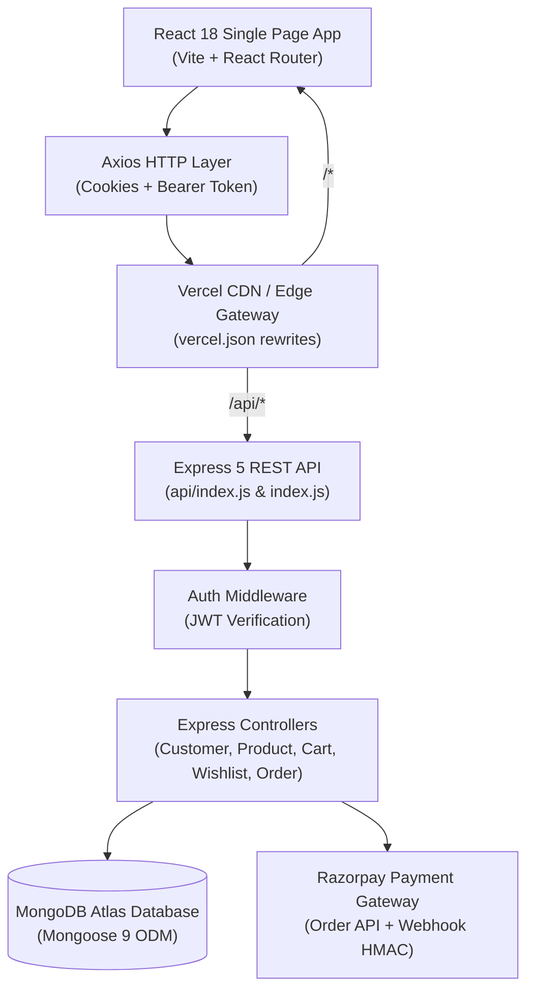
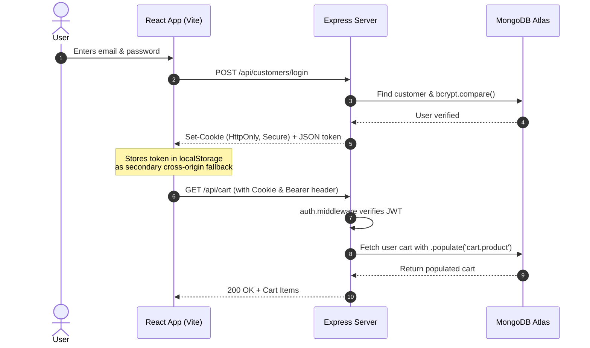

# 🛒 ShopKart — Modern Full-Stack E-Commerce Platform

[](https://shop-kart-8ai1.vercel.app)
[](https://react.dev/)
[](https://expressjs.com/)
[](https://www.mongodb.com/)
[](https://razorpay.com/)
[](https://nodejs.org/)

**ShopKart** is a production-grade, full-stack MERN e-commerce application designed with a sleek glassmorphic UI, robust RESTful APIs, JWT-based dual-layer authentication, persistent shopping cart and wishlist management, Razorpay payment processing, and zero-downtime deployment on Vercel.

🔗 **Live Deployment:** [https://shop-kart-8ai1.vercel.app](https://shop-kart-8ai1.vercel.app)  
📦 **Repository:** [https://github.com/HARSH10251/ShopKart](https://github.com/HARSH10251/ShopKart)

---

## 📑 Table of Contents
1. [Key Features](#-key-features)
2. [Architecture & System Design](#-architecture--system-design)
3. [Tech Stack](#-tech-stack)
4. [File & Directory Structure](#-file--directory-structure)
5. [Database Architecture & Schemas](#-database-architecture--schemas)
6. [API Specification & Endpoints](#-api-specification--endpoints)
7. [Getting Started (Local Development)](#-getting-started-local-development)
8. [Environment Variables](#-environment-variables)
9. [Automated Testing & QA](#-automated-testing--qa)
10. [Cloud Deployment (Vercel & Render)](#-cloud-deployment-vercel--render)
11. [Authors & Acknowledgments](#-authors--acknowledgments)

---

## ✨ Key Features

### 🔐 1. Authentication & Security
- **Dual-Layer Token Authentication**: Uses **JWT** tokens stored in secure `HttpOnly` cookies, paired with an automated client-side `Authorization: Bearer <token>` fallback in `localStorage` for cross-site cookie privacy compatibility.
- **Password Protection**: Multi-round hashing with **bcrypt** (salt rounds = 10) ensures user credentials are never stored in plain text.
- **Protected Routes**: Client-side route guards (`<ProtectedRoute />`) redirect unauthenticated visitors to `/login`, while backend middleware (`auth.middleware.js`) blocks unauthorized API access.

### 🛍️ 2. Product Discovery & Catalog
- **Instant Search & Filter**: Real-time keyword search with debouncing, dynamic category filtering (Electronics, Fashion, Books, Home), and price sorting (`asc` / `desc`).
- **Product Details View**: Dedicated view (`/products/:id`) featuring high-resolution image galleries, rich descriptions, dynamic in-stock/out-of-stock badges, and one-click cart/wishlist toggles.
- **Database Seeding**: Built-in seeding script (`node seed_products.js`) with realistic catalog items across multiple categories.

### 💖 3. Interactive Wishlist
- **ObjectId Referencing**: Zero data duplication—wishlist items are saved as MongoDB `ObjectId` references and populated on-demand with `.populate()`.
- **Duplicate Prevention**: Backend enforces unique entries with `409 Conflict` checks and UI action throttling.
- **Reactive Badges**: Global Navbar synchronizes the live wishlist item count (`Wishlist (N)`) across all views.
- **One-Click Toggle**: Atomic toggle endpoint (`PATCH /wishlist/:id/toggle`) enables instant save/unsave actions.

### 🛒 4. Persistent Shopping Cart
- **Centralized CartContext**: Unified global state management managing additions, deletions, and quantity updates.
- **Stock Limit Enforcement**: Prevents customers from requesting more items than are physically available in inventory.
- **Dynamically Calculated Totals**: Subtotal and item counts are derived dynamically on each request to prevent stale pricing anomalies.

### 💳 5. Checkout & Razorpay Integration
- **Indian Address Validation**: Shipping form with real-time validation (10-digit mobile number, 6-digit PIN code, city, state, street address).
- **Official Razorpay Checkout**: Seamless modal popup using Razorpay's JavaScript SDK (`checkout.js`) with instant payment order generation.
- **Cryptographic Signature Verification**: Server-side HMAC SHA256 validation verifies payment authenticity before committing orders to `paid` status.
- **Dev Mode Test Simulation**: Built-in test payment simulation endpoint for instant developer checkout testing without active banking credentials.

### 📦 6. Order Tracking & Lifecycle
- **Order History**: Dedicated `/orders` screen with purchase history, timestamp, status tags, and delivery summaries.
- **Single Order Breakdown**: View individual receipts (`/order-success/:id` and `/orders/:id`) with populated product summaries and tracking information.
- **Status Progression**: Live progression pipeline (`pending` $\rightarrow$ `paid` $\rightarrow$ `processing` $\rightarrow$ `shipped` $\rightarrow$ `delivered`).

---

## 🏛️ Architecture & System Design

### High-Level System Architecture


### Authentication & Session Lifecycle


---

## 💻 Tech Stack

| Domain | Technology | Description |
| :--- | :--- | :--- |
| **Frontend** | [React 18](https://react.dev/) | Component-driven user interface |
| **Build Tool** | [Vite 6](https://vitejs.dev/) | Next-generation frontend tooling and fast HMR |
| **Routing** | [React Router v7](https://reactrouter.com/) | Declarative client-side routing and protected routes |
| **State Management** | React Context API | Centralized Cart and Session state management |
| **Icons & UI** | [Lucide React](https://lucide.dev/) | Modern SVG iconography with customized Glassmorphic styling |
| **HTTP Client** | [Axios](https://axios-http.com/) | Promise-based HTTP client with request interceptors |
| **Backend** | [Express 5](https://expressjs.com/) | RESTful API backend framework for Node.js |
| **Database** | [MongoDB Atlas](https://www.mongodb.com/atlas) | Cloud-hosted NoSQL document database |
| **ODM** | [Mongoose 9](https://mongoosejs.com/) | Elegant MongoDB object modeling for Node.js |
| **Authentication** | [jsonwebtoken (JWT)](https://jwt.io/) & [bcrypt](https://www.npmjs.com/package/bcrypt) | Cryptographic user tokens and salted password hashing |
| **Payment Gateway** | [Razorpay SDK](https://razorpay.com/) | Digital payment infrastructure with HMAC verification |
| **Hosting & CI/CD** | [Vercel](https://vercel.com/) | Serverless cloud deployment with edge distribution |

---

## 📁 File & Directory Structure

```
ShopKart/
├── api/
│   └── index.js                 # Vercel Serverless Function entrypoint wrapping Express app
├── config/
│   └── razorpay.js              # Razorpay SDK initialization with test keys
├── controllers/
│   ├── customer.controller.js   # Auth: register, login, profile, logout, changePassword
│   ├── product.controller.js    # Catalog: getProducts, getProductById, createProduct
│   ├── wishlist.controller.js   # Wishlist: addToWishlist, getWishlist, removeFromWishlist, toggleWishlist
│   ├── cart.controller.js       # Cart: addToCart, getCart, updateCartQuantity, removeFromCart
│   └── order.controller.js      # Orders: createPaymentOrder, verifyPayment, getOrders, getOrderById
├── middlewares/
│   └── auth.middleware.js       # Extracts & validates JWT from Cookie or Authorization header
├── models/
│   ├── customer.model.js        # Customer schema (name, email, password, wishlist, cart)
│   ├── product.model.js         # Product schema (name, price, category, stock, image)
│   ├── order.model.js           # Order schema (items, shippingAddress, paymentStatus, razorpay details)
│   └── user.model.js            # Customer model alias for backwards compatibility
├── routes/
│   ├── customer.routes.js       # Customer routes (/customers/*)
│   ├── product.routes.js        # Product routes (/products/*)
│   ├── wishlist.routes.js       # Wishlist routes (/wishlist/*)
│   ├── cart.routes.js           # Shopping cart routes (/cart/*)
│   └── order.routes.js          # Order and payment routes (/orders/*)
├── src/
│   ├── components/
│   │   ├── Navbar.jsx           # Global navigation header with dynamic cart/wishlist counters
│   │   ├── ProductCard.jsx      # Catalog item card with wishlist quick-actions
│   │   ├── WishlistCard.jsx     # Wishlist product card with removal and detail navigation
│   │   ├── CartItem.jsx         # Cart row with interactive increment/decrement counters
│   │   ├── ProtectedRoute.jsx   # Client-side authentication route wrapper
│   │   └── SearchBar.jsx        # Search input with live debouncing and category selects
│   ├── context/
│   │   └── CartContext.jsx      # Global React Context provider managing cart state and actions
│   ├── pages/
│   │   ├── Home.jsx             # User dashboard and welcome landing page
│   │   ├── Products.jsx         # Discover products page with multi-facet filters
│   │   ├── ProductDetails.jsx   # Full product specification view
│   │   ├── Wishlist.jsx         # Dedicated wishlist management page
│   │   ├── Cart.jsx             # Shopping cart review and cost breakdown
│   │   ├── Checkout.jsx         # Indian shipping details and Razorpay checkout triggers
│   │   ├── OrderConfirmation.jsx# Post-purchase receipt with order tracking summary
│   │   ├── Orders.jsx           # Customer's historical orders list
│   │   ├── OrderDetails.jsx     # Deep-dive view of a single order
│   │   ├── Login.jsx            # Sign in form
│   │   └── Register.jsx         # Account creation form
│   ├── services/
│   │   └── api.js               # Centralized Axios client with automatic Bearer token interceptor
│   ├── App.jsx                  # Main routing tree and session state distributor
│   ├── main.jsx                 # Vite React DOM root entrypoint
│   └── index.css                # Global Glassmorphic design system and CSS styling
├── utils/
│   └── generateToken.js         # JWT generation with production-ready sameSite: none cookies
├── index.js                     # Main Express server, database connection caching, and CORS setup
├── seed_products.js             # Standalone catalog seeding script with sample inventory
├── test_cart_suite.js           # Automated integration test suite for Shopping Cart
├── test_order_suite.js          # Automated integration test suite for Orders & Razorpay
├── test_wishlist_suite.js       # Automated integration test suite for Wishlist
├── vite.config.js               # Vite bundler configuration and local proxy rules
├── vercel.json                  # Vercel serverless routing and SPA URL rewrite rules
├── package.json                 # Project dependencies, scripts, and engine specifications
└── .env.example                 # Template for local and production environment variables
```

---

## 🗄️ Database Architecture & Schemas

### 1. Customer Schema (`models/customer.model.js`)
Stores user identity, security hashes, and relationship arrays referencing products:
```javascript
{
  fullName: { type: String, required: true, trim: true },
  email:    { type: String, required: true, unique: true, lowercase: true },
  password: { type: String, required: true, minlength: 6 },
  phone:    { type: String, required: true },
  wishlist: [{ type: mongoose.Schema.Types.ObjectId, ref: "Product" }],
  cart: [
    {
      product:  { type: mongoose.Schema.Types.ObjectId, ref: "Product", required: true },
      quantity: { type: Number, required: true, min: 1, default: 1 }
    }
  ]
}
```

### 2. Product Schema (`models/product.model.js`)
Source of truth for store inventory and catalog details:
```javascript
{
  name:        { type: String, required: true, trim: true },
  description: { type: String, required: true },
  price:       { type: Number, required: true, min: 0 },
  category:    { type: String, required: true, enum: ["Electronics", "Fashion", "Books", "Home", "Other"] },
  image:       { type: String, required: true },
  stock:       { type: Number, required: true, min: 0, default: 0 }
}
```

### 3. Order Schema (`models/order.model.js`)
Commitment record storing purchased items snapshot, address, and Razorpay transaction records:
```javascript
{
  customer:        { type: mongoose.Schema.Types.ObjectId, ref: "Customer", required: true },
  items: [
    {
      product:  { type: mongoose.Schema.Types.ObjectId, ref: "Product", required: true },
      name:     { type: String, required: true },
      price:    { type: Number, required: true },
      quantity: { type: Number, required: true, min: 1 }
    }
  ],
  totalAmount:     { type: Number, required: true },
  shippingAddress: {
    fullName:     { type: String, required: true },
    phone:        { type: String, required: true },
    addressLine1: { type: String, required: true },
    city:         { type: String, required: true },
    state:        { type: String, required: true },
    pincode:      { type: String, required: true }
  },
  paymentStatus:   { type: String, enum: ["pending", "paid", "failed"], default: "pending" },
  orderStatus:     { type: String, enum: ["pending", "processing", "shipped", "delivered", "cancelled"], default: "pending" },
  razorpayOrderId:   { type: String },
  razorpayPaymentId: { type: String },
  razorpaySignature: { type: String }
}
```

---

## 🔌 API Specification & Endpoints

All endpoints support both standard root routes (`/customers`, `/products`, etc.) and serverless prefixed routes (`/api/customers`, `/api/products`, etc.).

### 🩺 Health & Diagnostic
| Method | Endpoint | Auth | Description |
| :--- | :--- | :---: | :--- |
| `GET` | `/health` or `/api/health` | ❌ | Healthcheck status and database connection state |

### 👤 Customer & Authentication
| Method | Endpoint | Auth | Description | Payload |
| :--- | :--- | :---: | :--- | :--- |
| `POST` | `/customers/register` | ❌ | Register new account | `{ fullName, email, password, phone }` |
| `POST` | `/customers/login` | ❌ | Sign in & receive session cookie / token | `{ email, password }` |
| `GET` | `/customers/me` | ✅ | Fetch currently authenticated user | None |
| `POST` | `/customers/logout` | ✅ | Terminate session & clear cookies | None |
| `PATCH` | `/customers/change-password` | ✅ | Update account password | `{ oldPassword, newPassword }` |

### 📦 Products Catalog
| Method | Endpoint | Auth | Description | Query Parameters |
| :--- | :--- | :---: | :--- | :--- |
| `GET` | `/products` | ❌ | Fetch products with search & filters | `?search=&category=&sort=` |
| `GET` | `/products/:id` | ❌ | Fetch single product by ID | None |
| `POST` | `/products` | ✅ | Create new product listing | `{ name, price, stock, category, image, description }` |

### 💖 Wishlist
| Method | Endpoint | Auth | Description |
| :--- | :--- | :---: | :--- |
| `GET` | `/wishlist` | ✅ | Retrieve populated wishlist items for current user |
| `POST` | `/wishlist/:productId` | ✅ | Add product reference to wishlist |
| `DELETE` | `/wishlist/:productId` | ✅ | Remove product reference from wishlist |
| `PATCH` | `/wishlist/:productId/toggle`| ✅ | Atomically toggle wishlist status (add/remove) |

### 🛒 Shopping Cart
| Method | Endpoint | Auth | Description | Payload |
| :--- | :--- | :---: | :--- | :--- |
| `GET` | `/cart` | ✅ | Fetch populated cart with live stock | None |
| `POST` | `/cart/:productId` | ✅ | Add item to cart or increment quantity | None |
| `PATCH` | `/cart/:productId` | ✅ | Update item quantity in cart | `{ quantity: 3 }` |
| `DELETE` | `/cart/:productId` | ✅ | Remove product from cart | None |

### 💳 Orders & Razorpay Checkout
| Method | Endpoint | Auth | Description | Payload |
| :--- | :--- | :---: | :--- | :--- |
| `POST` | `/orders/create-payment-order` | ✅ | Create Razorpay order & pending ShopKart order | `{ shippingAddress: { ... } }` |
| `POST` | `/orders/verify-payment` | ✅ | Verify HMAC SHA256 payment signature | `{ shopKartOrderId, razorpay_order_id, razorpay_payment_id, razorpay_signature }` |
| `POST` | `/orders/simulate-test-payment`| ✅ | Dev simulation bypassing Razorpay modal | `{ shopKartOrderId }` |
| `GET` | `/orders` | ✅ | Fetch all historical orders for current user | None |
| `GET` | `/orders/:id` | ✅ | Fetch detailed single order by ID | None |
| `PATCH` | `/orders/:id/status` | ✅ | Advance order status progression | `{ status: "shipped" }` |

---

## 🚀 Getting Started (Local Development)

### 1. Prerequisites
- **Node.js** v18.0.0 or higher
- **npm** v9.0.0 or higher
- **MongoDB** (Local instance or free [MongoDB Atlas](https://www.mongodb.com/atlas) cluster)

### 2. Clone the Repository
```bash
git clone https://github.com/HARSH10251/ShopKart.git
cd ShopKart
```

### 3. Install Dependencies
```bash
npm install
```

### 4. Configure Environment Variables
Copy the example environment configuration:
```bash
cp .env.example .env
```
Open `.env` and fill in your connection details:
```env
PORT=5001
MONGO_URI=mongodb+srv://<username>:<password>@cluster0.wcldgqy.mongodb.net/shopkart?retryWrites=true&w=majority
JWT_SECRET=your_jwt_secret_key_here
NODE_ENV=development
RAZORPAY_KEY_ID=rzp_test_yourKeyId
RAZORPAY_KEY_SECRET=yourKeySecret
VITE_RAZORPAY_KEY_ID=rzp_test_yourKeyId
```

### 5. Seed the Product Catalog
Populate your database with sample catalog items:
```bash
node seed_products.js
```

### 6. Run the Application
Open two terminal tabs:

**Terminal 1 — Backend Server:**
```bash
npm run server
# Express listening on http://localhost:5001
```

**Terminal 2 — Frontend Development Server:**
```bash
npm run dev
# Vite server running on http://localhost:5173
```
Open your browser and navigate to `http://localhost:5173`.

---

## 🔑 Environment Variables

| Variable Name | Environment | Description |
| :--- | :---: | :--- |
| `PORT` | Backend | Port for persistent Express server (Default: `5001`) |
| `MONGO_URI` | Backend | MongoDB connection URI (Atlas SRV or direct replica set string) |
| `JWT_SECRET` | Backend | Secret string used for signing and verifying JWT tokens |
| `NODE_ENV` | Both | `development` for local or `production` for deployments |
| `CLIENT_URL` | Backend | Optional custom client origin allowed by CORS |
| `RAZORPAY_KEY_ID` | Backend | Razorpay Test API Key ID |
| `RAZORPAY_KEY_SECRET` | Backend | Razorpay Test API Key Secret |
| `VITE_RAZORPAY_KEY_ID`| Frontend | Razorpay Key ID exposed to frontend checkout script |
| `VITE_API_BASE_URL` | Frontend | Backend API URL (leave blank on Vercel all-in-one; set to Render URL if separated) |

---

## 🧪 Automated Testing & QA

ShopKart includes dedicated end-to-end integration test suites targeting actual MongoDB databases and Express route layers.

```bash
# Run the complete Checkout & Razorpay Order test suite
npm test

# Run specific feature suites:
npm run test:orders     # Verifies Orders, Payments, Address validation, Stock deduction
npm run test:cart       # Verifies Cart operations, Stock ceilings, and Quantity mutations
npm run test:wishlist   # Verifies Wishlist referencing, Population, and Toggle states
```

---

## ☁️ Cloud Deployment (Vercel & Render)

### Option A: Complete Deployment on Vercel (Recommended)
ShopKart is configured to deploy both frontend and backend serverless functions simultaneously using [`vercel.json`](file:///Users/harry/ShopKart/vercel.json) and [`api/index.js`](file:///Users/harry/ShopKart/api/index.js):

1. Push your repository to **GitHub**.
2. Go to [Vercel](https://vercel.com) and click **Add New Project** $\rightarrow$ **Import ShopKart**.
3. In **Settings** $\rightarrow$ **Environment Variables**, add:
   - `MONGO_URI` = *Your MongoDB Atlas connection string*
   - `JWT_SECRET` = *Your secure JWT secret*
   - `NODE_ENV` = `production`
   - `RAZORPAY_KEY_ID` = `rzp_test_...`
   - `RAZORPAY_KEY_SECRET` = `...`
   - `VITE_RAZORPAY_KEY_ID` = `rzp_test_...`
4. In **MongoDB Atlas** $\rightarrow$ **Network Access**, ensure `0.0.0.0/0` (Allow Access from Anywhere) is active.
5. Click **Deploy**. Vercel will build the Vite frontend to `dist/` and wrap `/api` as a Serverless Function.

### Option B: Separate Backend (Render) & Frontend (Vercel)
If you prefer a persistent Express process:
1. **Backend on Render**:
   - Create a **Web Service** on [render.com](https://render.com) pointing to the repository.
   - Build Command: `npm install` | Start Command: `npm start`
   - Add environment variables (`MONGO_URI`, `JWT_SECRET`, `NODE_ENV=production`, etc.).
2. **Frontend on Vercel**:
   - Import the repository on [Vercel](https://vercel.com).
   - Set Environment Variable `VITE_API_BASE_URL = https://your-backend.onrender.com`.
   - Click **Deploy**.

---

## 👨‍💻 Authors & Acknowledgments

- **Developer**: Harsh ([@HARSH10251](https://github.com/HARSH10251))
- **Course / Module**: Full-Stack Web Development — E-Commerce Systems
- **License**: ISC License

---
⭐ *If you find this project helpful, please consider starring the repository!*
